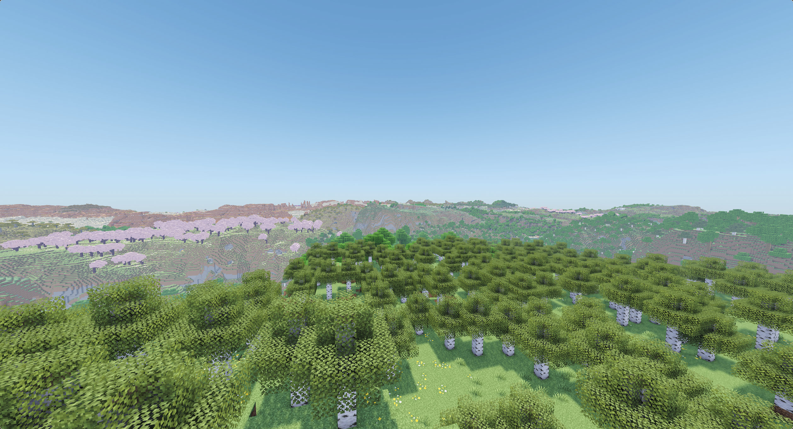

# worldgen-rs

A Rust library for generating Minecraft worlds. It reads vanilla and custom datapacks, JIT-compiles their density functions, and generates chunks that match vanilla's output.



<sub>*In-game screenshot, rendered with [Voxy](https://modrinth.com/mod/voxy) and [Complementary Shaders](https://modrinth.com/shader/complementary-reimagined).*</sub>


## Status

This project is in a very experimental state. The API is not stable and is subject to change.

Generation runs through `ChunkStatus::Features`. `InitializeLight`, `Light`, `Spawn`, and `Full` are not implemented and return `Error::Unsupported`.


## Features

- Loads worldgen from a datapack directory or `.zip`, layered over vanilla data
- Density functions JIT-compiled to native code with [Cranelift](https://cranelift.dev/)
- Biomes, noise, surface rules, carvers, features, and structures
- Overworld, nether, and end, plus datapack-defined dimensions
- Parallel chunk generation on a Rayon pool


## Installation

This crate requires a nightly toolchain, since it uses `portable_simd` and several `const` trait features. The pinned version is in `rust-toolchain.toml`.

```toml
[dependencies]
worldgen-rs = { git = "https://github.com/garfxld/worldgen-rs" }
```


## Usage

```rust
use worldgen_rs::{ChunkPos, ChunkStatus, Identifier, Worldgen, WorldgenSettings};

let settings = WorldgenSettings::new(42, Identifier::const_vanilla("overworld"));
let worldgen = Worldgen::new(settings)?;

let top = worldgen.generate(ChunkPos::new(0, 0), ChunkStatus::Features, |view| {
    view.get_relative_block(0, (view.height() - 1) as usize, 0)
})?;
```

`generate` takes a closure rather than returning the chunk, so the chunk data is read under the store's lock and never copied out wholesale. `ChunkView` exposes block and biome lookups, the dimension's `min_y` and `height`, and iterators over both.

To use a custom datapack, layer it over the built-in one:

```rust
use worldgen_rs::datapack::Datapack;

let pack = Datapack::zip("Terralith.zip")?.layered_over(Datapack::builtin());
let settings = WorldgenSettings::new(42, Identifier::const_vanilla("overworld"))
    .with_datapack(pack);
```


## Examples

Both examples use [cerium](https://github.com/garfxld/cerium) to start a real server you can join.

```bash
cargo run --release --example vanilla
cargo run --release --example datapack <datapack.zip|directory> [dimension]
```


## Roadmap

- [x] Structure starts and references
- [x] Biomes
- [x] Noise
- [x] Surface rules
- [x] Carvers
- [x] Features
- [x] Datapack loading (directory and `.zip`, layered)
- [x] JIT-compiled density functions
- [x] Structures, including jigsaw assembly
- [x] Overworld, nether, and end, plus datapack-defined dimensions
- [x] Parallel chunk generation
- [ ] Lighting
- [ ] Loot tables
- [ ] Entity spawning
- [ ] Performance improvements


## License

This project is licensed under [Apache-2.0](LICENSE).
